<p align="center">
  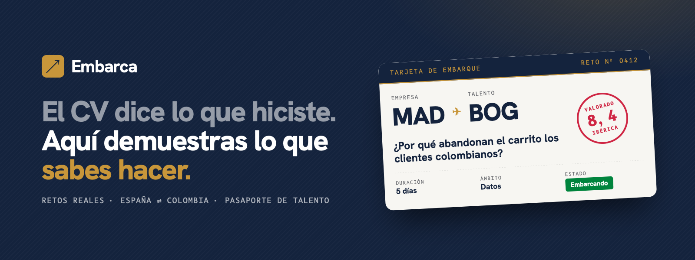
</p>

<p align="center">
  <b>Retos reales de empresas para el talento joven de España y Colombia.<br>Cada entrega valorada es un sello en tu pasaporte de talento, ganes o no.</b>
</p>

<p align="center">
  <a href="https://club-hispanidad-futura.vercel.app"><b>Ver la demo en vivo →</b></a>
  &nbsp;·&nbsp;
  <a href="https://club-hispanidad-futura.vercel.app/demo">Recorrido guiado</a>
  &nbsp;·&nbsp;
  <a href="docs/hackathon/RECAP.md">Cómo lo construimos</a>
</p>

<p align="center">
  
  
  
  
  
  
  
</p>

---

**Embarca** nació en un día, el 10 de octubre de 2026, en la **Hackathon Iberoamérica 2030 del Club Hispanidad Futura** (Madrid). El reto: *convertir la comunidad iberoamericana en una plataforma tecnológica de oportunidades para el talento joven*, piloteable en 90 días entre al menos dos países.

<p align="center">
  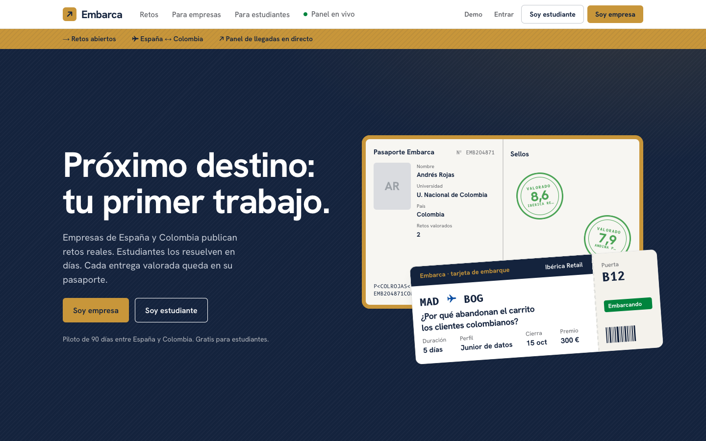
</p>

## El problema

> **El talento joven no tiene cómo demostrar lo que sabe hacer. Y entre países, menos: el título no viaja; una valoración de una empresa real, sí.**

- En España el **22,7 %** de los menores de 25 años está en paro (Eurostat, agosto de 2026). En Colombia, el **14,1 %** de los jóvenes (DANE).
- A la vez, el **78 %** de las empresas tecnológicas españolas no logra cubrir sus vacantes (ManpowerGroup, 2026).
- Las ofertas junior piden experiencia, y la experiencia se consigue con contactos. **Sin experiencia no hay trabajo; sin trabajo no hay experiencia.**

Análisis completo, con fuentes: [`docs/negocio/PROBLEMA.md`](docs/negocio/PROBLEMA.md).

## La solución

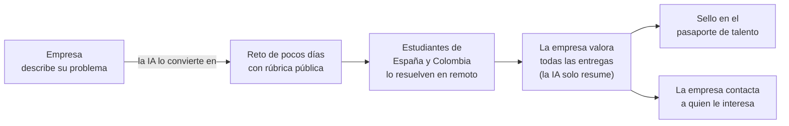

1. **La empresa cuenta lo que necesita** con sus palabras. La IA lo convierte en un reto acotado: enunciado, entregable, plazo y rúbrica.
2. **Estudiantes de España y Colombia lo resuelven** en remoto, sin CV ni visado, sabiendo desde el principio cómo se les va a valorar.
3. **La empresa ve el trabajo antes de contratar.** La IA resume cada entrega frente a la rúbrica; la nota y la decisión las pone una persona.
4. **Si no ganas, no pierdes:** cada entrega valorada queda como un sello en tu **pasaporte de talento**, que vale en los dos países.

## La app

| Estudiante: inicio | Estudiante: pasaporte de talento |
|---|---|
| 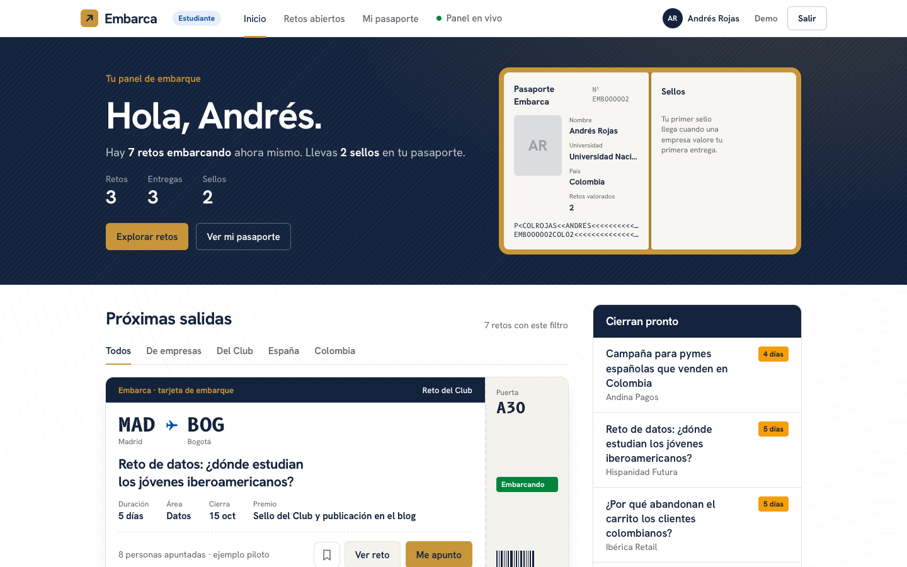 | 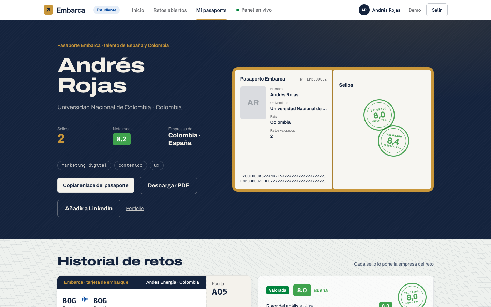 |
| **Empresa: panel ("tu terminal")** | **Empresa: valorar entregas** |
| 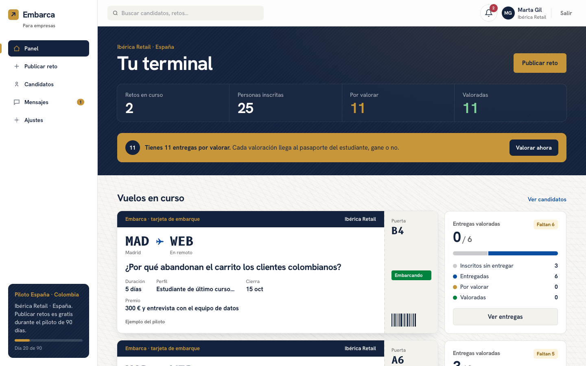 | 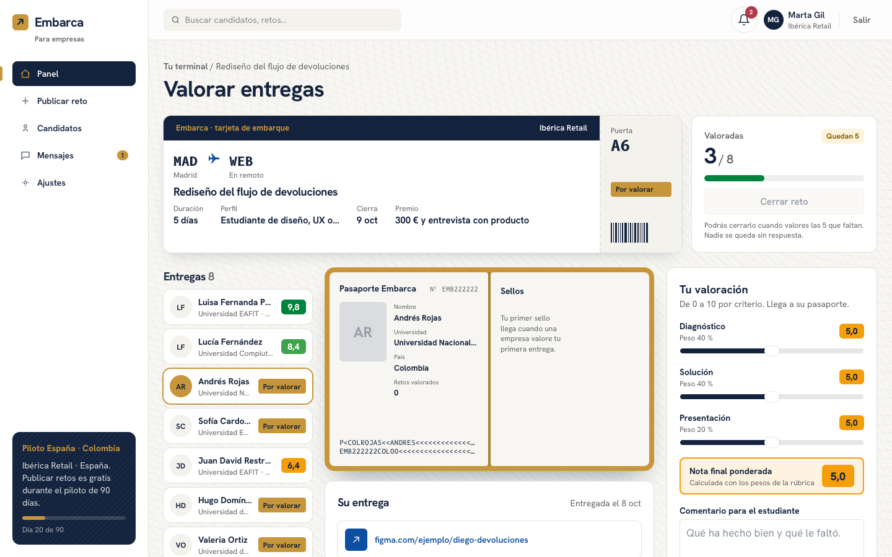 |
| **Empresa: publicar un reto con IA** | **Estudiante: un reto, con su rúbrica** |
| 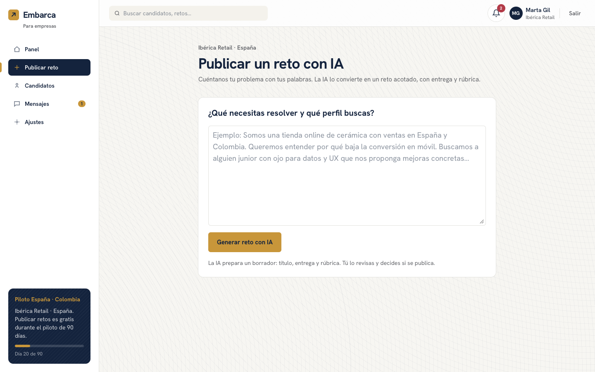 | 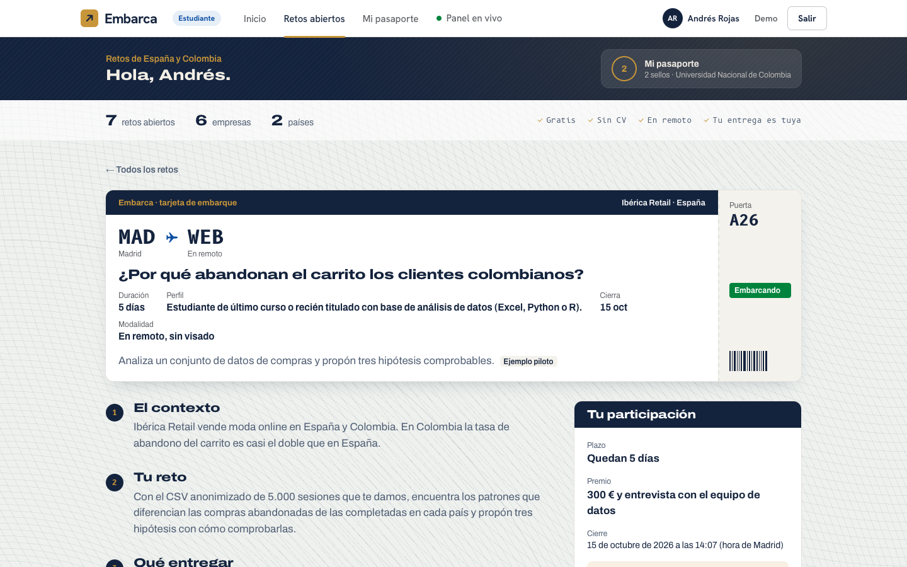 |

<p align="center">
  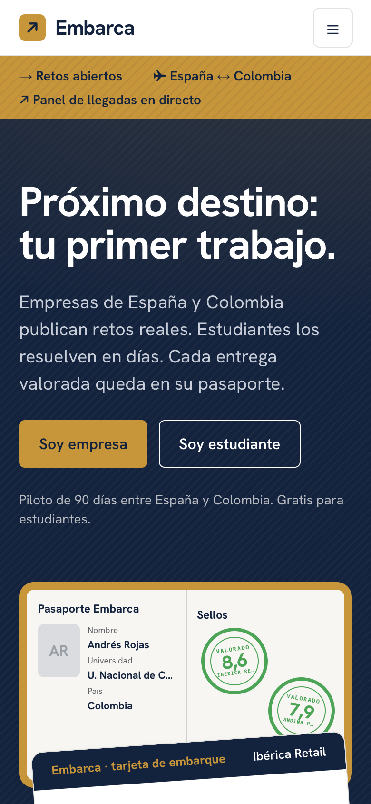
  &nbsp;
  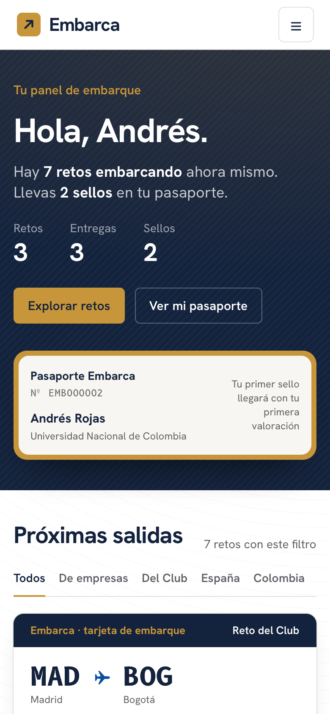
  &nbsp;
  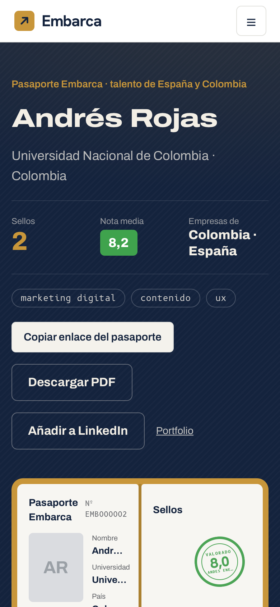
</p>

### Para el estudiante
- **Inicio tipo feed** con retos de empresas y del Club, actividad de otros estudiantes y retos que cierran pronto.
- **Cada reto es una tarjeta de embarque**: ruta, plazo, premio y la rúbrica con sus pesos.
- **Apuntarse y entregar** un enlace y una explicación.
- **Pasaporte de talento público**: página de identidad, banda de lectura mecánica y un sello por cada reto valorado, con nota por criterio y feedback.

### Para la empresa
- **Publicar un reto con IA** a partir de texto libre, con avisos si lo que se pide es trabajo de producción o demasiado largo.
- **Panel** con retos en curso, inscritos, entregas por valorar y candidatos de los dos países.
- **Valorar**: resumen de la IA por entrega, nota con deslizadores por criterio, feedback y "quiero contactar".
- **Candidatos, mensajes y ajustes** (plan, equipo, integraciones).

### Panel en vivo
Un tablero de llegadas con los **registros reales** del día. Los datos de ejemplo no cuentan: el reto pedía *cualificar demanda real*.

## IA responsable

- **La IA prepara; decide una persona.** Monta el reto y resume las entregas, pero **no pone notas ni ordena candidatos**. Evaluar personas con IA es de alto riesgo en la Ley de IA de la UE.
- No usa nombre, país, universidad ni género para resumir una entrega.
- Interruptor `AI_ENABLED`: con él apagado, la app usa una **IA simulada** que construye un resultado creíble a partir del texto real, sin llamar a ningún modelo. Así la demo no depende de la red ni de una clave. Con él encendido, usa Claude (`src/lib/ai/`).

## Marca

**Embarca** usa la señalética de un aeropuerto: los retos son **tarjetas de embarque**, los estados son los de un **panel de salidas** (*Embarcando*, *Cierra pronto*, *Por valorar*, *Cerrado*) y cada valoración es un **sello** en el pasaporte. Marino y oro del Club Hispanidad Futura, Hanken Grotesk y B612 Mono (la tipografía de las cabinas de avión). Guía completa en [`docs/producto/BRANDING.md`](docs/producto/BRANDING.md).

## Arquitectura

| Capa | Tecnología |
|---|---|
| Web | Next.js 15 (App Router, Server Components y Server Actions), React 19, TypeScript |
| Estilos | Tailwind CSS 4, kit propio de Embarca (`src/components/embarca`) |
| Datos | Supabase (Postgres). Acceso solo desde el servidor; RLS activado sin políticas públicas |
| IA | Claude (Anthropic SDK), con modo simulado para la demo |
| Despliegue | Vercel (Frankfurt) y Supabase en la nube creado desde el Marketplace de Vercel |

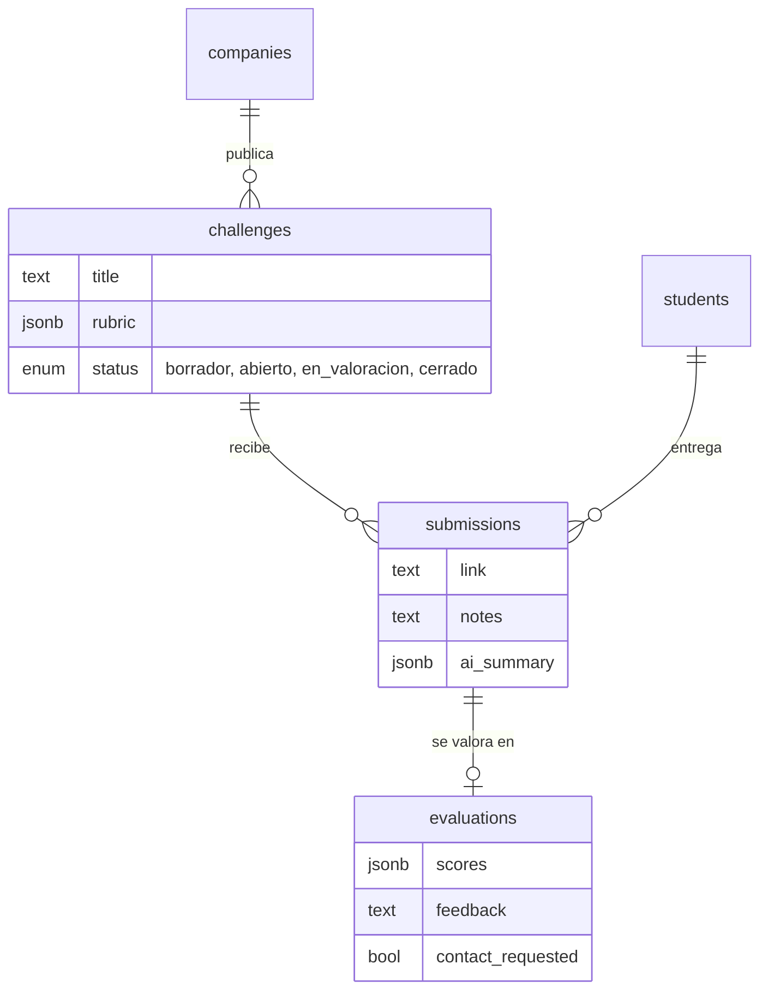

### Estructura

```
src/
├── app/
│   ├── page.tsx, _landing/     Portada
│   ├── registro/, entrar/      Alta y acceso (estudiante y empresa)
│   ├── estudiante/             Inicio del estudiante (feed)
│   ├── retos/                  Retos abiertos, detalle, apuntarse y entregar
│   ├── pasaporte/[id]/         Pasaporte de talento público
│   ├── empresa/                App de empresa: panel, publicar, valorar, candidatos, mensajes, ajustes
│   ├── panel/                  Panel en vivo (registros reales)
│   ├── demo/, qr/              Recorrido guiado de la demo y código QR
│   └── dev/sesion/             Atajo de sesión (solo con DEMO_MODE)
├── components/                 Cabecera, marca y kit visual de Embarca
├── lib/                        Supabase, sesión, tipos, modo demo
│   └── ai/                     Generar reto y resumir entrega (real y simulada)
└── middleware.ts               Accesos directos de la demo
supabase/
├── schema.sql                  Esquema (el contrato entre módulos)
└── seed.sql                    Datos de ejemplo del piloto (repetible)
docs/                           Producto, negocio, pitch, equipo y recap
design/                         Diseño en Pencil y referencias del logo del Club
```

## Arrancarlo en local

Necesitas Node 20+, Docker Desktop y la [CLI de Supabase](https://supabase.com/docs/guides/cli).

```bash
git clone https://github.com/aaangelmartin/ClubHispanidadFutura.git
cd ClubHispanidadFutura
npm install

supabase start               # base de datos local; carga schema.sql y seed.sql
cp .env.example .env.local   # rellena con lo que muestra `supabase status`
npm run dev                  # http://localhost:3000
```

| Variable | Para qué |
|---|---|
| `SUPABASE_URL` | URL de Supabase (en local, `http://127.0.0.1:54321`) |
| `SUPABASE_SERVICE_ROLE_KEY` | Clave de servidor de Supabase |
| `ANTHROPIC_API_KEY` | Clave de Claude (solo si `AI_ENABLED=true`) |
| `AI_ENABLED` | `true` usa Claude; `false` usa la IA simulada |
| `DEMO_MODE` | `true` activa `/demo`, `/empresa` y `/estudiante` sin login y los atajos de sesión |

Con `DEMO_MODE=true`:
- **[`/empresa`](https://club-hispanidad-futura.vercel.app/empresa)** entra como la empresa de ejemplo (Ibérica Retail).
- **[`/estudiante`](https://club-hispanidad-futura.vercel.app/estudiante)** entra como un estudiante de Bogotá.

## Negocio y piloto

- **Gratis para estudiantes y universidades.** Publicar un reto también es gratis.
- **La empresa paga** cuando quiere hablar con quien ha resuelto su reto, o por un plan premium ([`docs/negocio/NEGOCIO.md`](docs/negocio/NEGOCIO.md)).
- **Lanzamiento sin depender de las empresas al principio** ([`docs/negocio/LANZAMIENTO.md`](docs/negocio/LANZAMIENTO.md)):
  - los primeros retos los pone el Club;
  - los estudiantes llegan en clase, a través de sus profesores;
  - a la empresa se llega con resultados.
- **Piloto de 90 días** ([`docs/negocio/PILOTO-90-DIAS.md`](docs/negocio/PILOTO-90-DIAS.md)): una universidad en España y otra en Colombia, tres empresas, un perfil (tecnología junior). KPI clave: al menos el 90 % de las entregas valoradas.

## Cómo lo construimos

Cinco personas, **cada una con su propio agente de IA (Claude Code)**, en unas cinco horas:

- **La app dividida en cuatro partes verticales independientes** (entrada, publicar retos, resolver retos, valorar y pasaporte), más negocio y pitch. Cada persona le decía a su agente qué perfil era y trabajaba solo en lo suyo ([`docs/equipo/perfiles`](docs/equipo/perfiles/README.md)).
- **Los agentes se coordinaban por GitHub Issues**: etiquetas por perfil, `bloqueo` y `contrato` para cambios en lo compartido. Reglas comunes en [`AGENTS.md`](AGENTS.md).
- **Datos de ejemplo desde el minuto uno**, para que cada parte se probara sola.
- **Iteramos con los mentores:**
  - un nicho de entrada, como Airbnb con sus colchones;
  - la causa raíz con los cinco porqués;
  - la diferencia frente a HackerRank;
  - un roleplay con cada actor.

La historia completa, con decisiones, pivotes y los fallos que casi rompen la demo: [`docs/hackathon/RECAP.md`](docs/hackathon/RECAP.md). Toda la documentación: [`docs/`](docs/README.md).

## Estado

**Prototipo funcional.** Publicar, entregar, valorar y el pasaporte funcionan sobre una base de datos real. Para llevarlo a producción con usuarios falta:

- [ ] Login real con Supabase Auth ([#9](https://github.com/aaangelmartin/ClubHispanidadFutura/issues/9)) y `DEMO_MODE` apagado.
- [ ] IA real activada (`AI_ENABLED=true`).
- [ ] Revisión legal: RGPD, Ley 1581 de 2012 de Colombia y Ley de IA de la UE.
- [ ] Conectar las funciones que hoy son maqueta: mensajes, integraciones y PDF del pasaporte.

## Equipo

| | Rol |
|---|---|
| **Ángel Martín** ([@aaangelmartin](https://github.com/aaangelmartin)) | Marca Embarca, portada, registro y panel en vivo |
| **Álvaro Carpintero** ([@alvaarocl](https://github.com/alvaarocl)) | Panel de empresa, valoración, pasaporte, feed, infraestructura y despliegue |
| **Alex Serrano** ([@alexSerranoR](https://github.com/alexSerranoR)) | Publicar retos con IA |
| [@adricervantesm](https://github.com/adricervantesm) | Resolver retos (lado del estudiante) |
| **Thameur Triki** ([@thameurtriki](https://github.com/thameurtriki)) | Negocio, modelo y pitch |

Hecho en la Hackathon Iberoamérica 2030 del Club Hispanidad Futura, Madrid, 10 de octubre de 2026.

<p align="center"></p>
